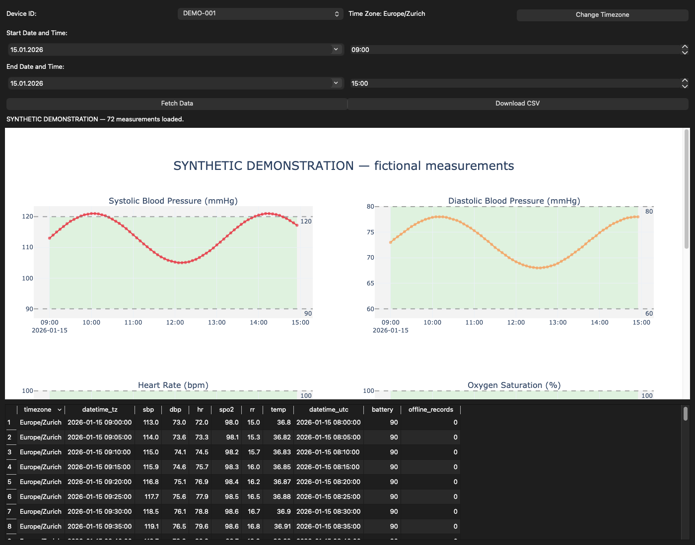
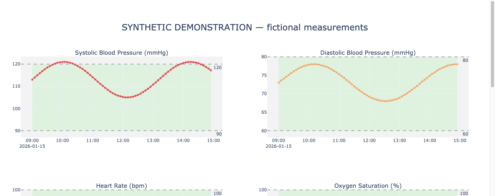
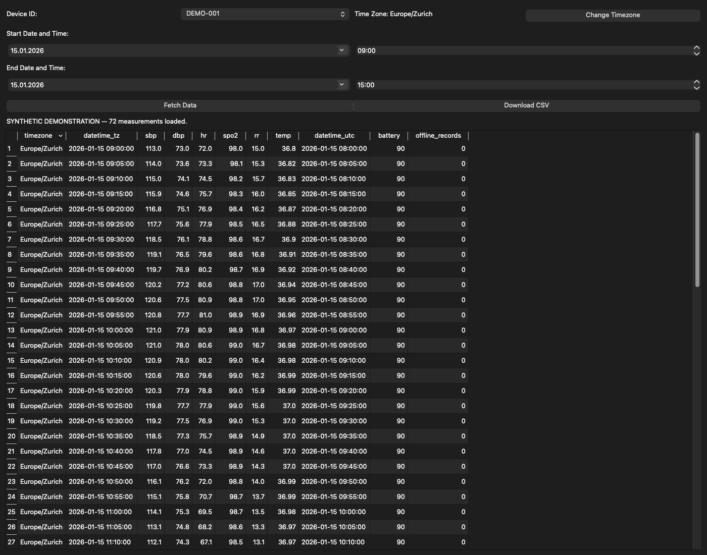

# Vitals Explorer — BioBeat Dashboard


An independently developed Python desktop application for exploring physiological measurements from BioBeat devices. It brings authenticated retrieval, timezone-aware processing, interactive plots, a data table, and CSV export into one research workflow.

Developed independently by the author using purchased, authorized BioBeat API access. BioBeat did not develop this application. The demo uses original neutral branding and synthetic data.

For recruiters: run `python main.py --demo`, then click **Fetch Data**. No API credentials or device access are needed.

## Features

- Retrieve physiological data through an authenticated REST API with bounded pagination.
- Select locally configured devices and a date/time range.
- Convert local time to UTC for requests and display measurements in a selected timezone.
- Explore six interactive Plotly charts: systolic and diastolic blood pressure, heart rate, oxygen saturation, respiratory rate, and temperature.
- Inspect normalized measurements in a Qt table and export them as CSV.
- Retrieve and process data in a Qt background worker while the interface stays responsive.
- Run without credentials using deterministic synthetic demonstration data.
- Package a desktop application with PyInstaller.

## Screenshots

These are captures of the actual application using **entirely synthetic measurements** and a fictional device. No participant data or live API access was used.







The table detail capture temporarily hides the plot through the capture script to show more rows. The normal application displays both views together. The screenshots show the export control; the script also verifies a synthetic CSV export.

Recreate the images in a desktop session with Qt WebEngine support:

```bash
python scripts/demo_screenshots.py
```

The script writes PNGs to `docs/images/` and an ignored `docs/synthetic-demo.csv`. To explore the same demo manually, run `python main.py --demo` and click **Fetch Data**. Demo mode always uses a fixed six-hour synthetic series, regardless of the selected time range; it never calls the API.

## Technical overview

```text
PyQt5 Desktop Interface
        |
        v
Qt Retrieval Worker
        |
        v
Authentication / API Client
        |
        v
Data Retrieval and Processing
        |
        +--> Interactive Plotly Dashboard
        +--> Qt Data Table
        +--> CSV Export
```

| Module | Responsibility |
| --- | --- |
| `main.py` | Qt widgets, background worker, result/error signals, application lifecycle, and export dialog. |
| `biobeat/config.py` | Environment validation and local device configuration. |
| `biobeat/auth.py` | OAuth2 client credentials request and safe authentication errors. |
| `biobeat/fetch.py` | Measurement requests, response validation, cancellable pagination, and loop protection. |
| `biobeat/utils.py` | Data normalization, timezone conversion, and CSV writing. |
| `biobeat/plot.py` | Six interactive physiological measurement plots. |
| `biobeat/demo.py` | Deterministic synthetic records, independent of API credentials. |
| `biobeat/errors.py` | Shared safe error types. |

Network requests use connect/read timeouts of 5/30 seconds and do not follow redirects. Responses, authorization headers, credentials, and measurement contents are omitted from application logs. Closing during retrieval requests cancellation and waits for the active request to return; the worker checks cancellation between pages. No worker updates widgets directly.

Plot HTML embeds Plotly locally and lives in a private temporary directory removed on normal shutdown. A crash can leave temporary files behind. CSV exports and temporary HTML contain measurement data when using live devices: store them according to your institution's data policy. Git ignore rules are a safeguard, not an access-control system.

## Installation

Use **Python 3.11 or 3.12** with a desktop session. Verification was performed on macOS with Python 3.12; Windows/Linux packaging still needs platform-specific verification. Qt WebEngine requires suitable system graphics libraries.

```bash
git clone https://github.com/kvongruenigen/vitals-explorer.git
cd vitals-explorer
python3.12 -m venv .venv
source .venv/bin/activate
python -m pip install --upgrade pip
python -m pip install -r requirements.txt
```

On Windows, create the environment with `py -3.12 -m venv .venv` and activate it with `.\.venv\Scripts\Activate.ps1`. Direct dependency versions are pinned; transitive Qt/runtime packages vary by platform.

## Configuration

For live access, copy `.env.example` to `.env` in the directory from which you launch the application, then fill it locally:

```bash
cp .env.example .env
```

| Variable | Meaning |
| --- | --- |
| `SCOPE` | Authorized OAuth2 scope supplied by BioBeat. |
| `CLIENTIDHASH` | Base64 client credentials for the existing Basic authentication contract. Treat as a secret. |
| `CUSTOMERPARAMETER3` | Relative measurement API path supplied by BioBeat. |
| `CUSTOMERPARAMETER4` | HTTP header name used to carry the access token. |
| `BIOBEAT_DEVICE_IDS` | Comma-separated authorized device IDs. The example uses fictional IDs only. |

Environment variables take precedence over `.env`. Live credentials are validated when retrieval starts. Missing device configuration displays a helpful status message and disables retrieval. IDs may contain letters, digits, hyphens, and underscores. Never commit a filled `.env`, real device IDs, participant identifiers, recordings, logs, or built executables. Example configuration does not provide live access.

## Running the application

From the repository root with the environment activated:

```bash
python main.py          # authorized live access
python main.py --demo   # synthetic data, no API calls
```

Choose a device, timezone, and start/end time, then click **Fetch Data**. The selected timezone continues to apply when its selector is hidden. Ambiguous and nonexistent daylight-saving times are rejected. Use **Download CSV** after a successful retrieval. An empty response clears the previous results; a failed request leaves the previous successful results available after controls are restored.

## Building executables

Install the development/build dependencies first:

```bash
python -m pip install -r requirements-dev.txt
```

Build on the target operating system; PyInstaller does not cross-compile:

```bash
./build_app.sh            # macOS/Linux
```

```powershell
.\building.ps1           # Windows; creates/reuses .venv and installs build dependencies
```

Output is placed in `dist/VitalsExplorer/` (and a macOS app bundle where produced). The Windows script reads `version_info.txt`. Configuration is provided at runtime from the launch working directory or environment; it is never bundled. Launch packaged demo mode from a terminal with `--demo`. Code signing, notarization, and installer distribution are separate manual release steps.

## Testing

```bash
python -m pip install -r requirements-dev.txt
python -m pytest -q
python -m ruff check main.py biobeat tests scripts
python -m compileall -q main.py biobeat scripts tests
```

The default suite mocks external requests and requires no credentials or devices. It covers configuration, authentication and transport failures, malformed/empty responses, pagination, timezone transitions, normalization, and CSV export. Optional Qt tests exercise responsiveness, failure recovery, and shutdown in a desktop session:

```bash
RUN_GUI_TESTS=1 python -m pytest -q  # macOS/Linux
```

In PowerShell, set `$env:RUN_GUI_TESTS="1"` before running pytest.

For privacy and demonstration scope, see [SECURITY.md](SECURITY.md).

## Limitations

- Live measurements require authorized BioBeat API access and device permissions.
- This application is intended for research data exploration.
- It is **not a certified medical device or clinical decision-support tool**. Chart shading and guide lines are illustrative, not clinical guidance.
- Pagination is capped at 1,000 pages; use a shorter interval for larger datasets. Incomplete retrievals fail rather than silently exporting partial results.
- The API schema is based on the existing integration and has been verified with mocked responses only. No real credentials or devices were used during hardening.

## Privacy

This portfolio uses synthetic data and original neutral branding. See [SECURITY.md](SECURITY.md) for privacy and demo scope.

## License

Copyright © 2026 Kay von Grünigen. The original source code, documentation, synthetic screenshots, and waveform icon are licensed under **GNU GPL version 3 only (GPL-3.0-only)**. See [LICENSE](LICENSE) for the full terms and [COPYRIGHT](COPYRIGHT) for the notice. The software is provided without warranty.

Third-party dependencies retain their own licenses. PyQt5 and PyQtWebEngine are available under GPLv3 or separate commercial licenses; this source release uses the GPL-compatible distribution path. The BioBeat API service and its access rights are separate from this software license. No vendor logos or research measurements are included in the portfolio snapshot.

Before distributing bundled executables, include all applicable third-party notices and meet the corresponding source and other license requirements for the exact bundled dependencies. This repository publishes source and synthetic screenshots; it does not include prebuilt executables.
